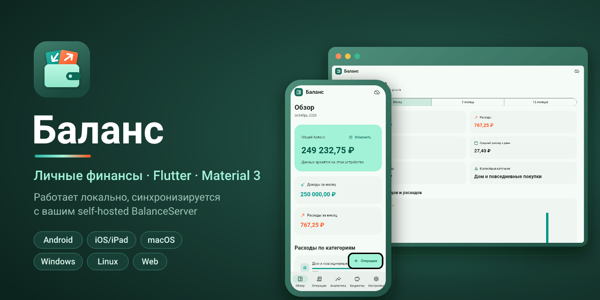
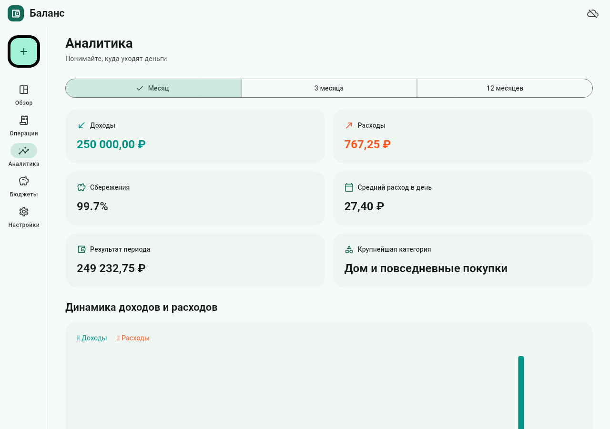
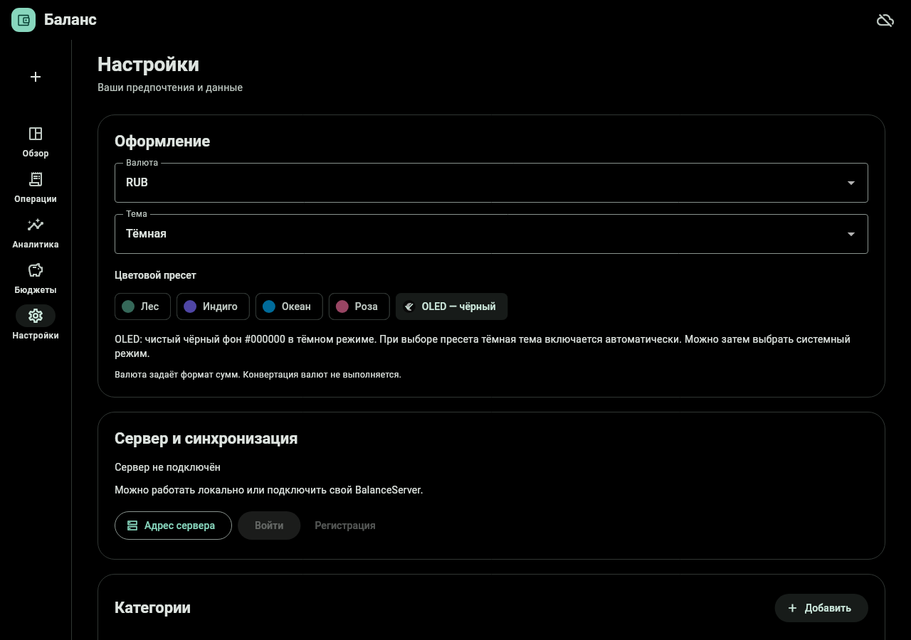

<p align="center">
  
</p>

# Баланс — Flutter / Material 3

Личный бюджет с локальным хранилищем и синхронизацией с существующим `BalanceServer`. Сервер и его протокол не переписаны. CloudKit удалён по запросу: данные синхронизируются только через Go-сервер.

## Возможности

- Доходы и расходы: создание, редактирование, удаление, дата/время, заметки, поиск, фильтр типа.
- Общий баланс, ручная корректировка отдельной операцией без влияния на аналитику.
- Аналитика за 1, 3 и 12 календарных месяцев, доходы/расходы, результат, сбережения, средний расход, крупнейшая категория, динамика и структура расходов.
- Месячные бюджеты по категориям, остаток и превышение; выбор месяца.
- Встроенные и собственные категории, 50 значков Material с совместимыми серверными именами, 30 эмодзи и собственный эмодзи, 24 цвета. Переименование обновляет связанные записи; удаление сохраняет историю.
- RUB, EUR, USD, SEK; системная, светлая и тёмная тема; пресеты Лес, Индиго, Океан, Роза и OLED; CSV-экспорт.
- OLED использует чистый чёрный фон `#000000` в тёмном режиме (включая карточки, навигацию и диалоги). При выборе OLED включается тёмная тема; затем можно выбрать системный режим. Режим и пресет сохраняются локально.
- Локальная работа без аккаунта; сервер, регистрация, вход, выход, refresh, ручная и автоматическая синхронизация, полная пересинхронизация.
- Транзакционное сохранение данных и курсора, очередь изменений и удалений, повтор после сетевого сбоя; отдельные хранилища аккаунтов.
- Адаптивная навигация: нижняя панель на телефоне, боковая на широком экране.



OLED-пресет:



## Платформы

| Платформа | Реализация / сборка |
| --- | --- |
| Android | Flutter, Android SDK и Java; APK/AAB |
| iPhone, iPad | Один iOS Flutter target; сборка на macOS с Xcode |
| macOS | Flutter runner; сборка на macOS с Xcode |
| Windows | Flutter runner; сборка на Windows с Visual Studio C++ Desktop |
| Linux | Flutter runner; GTK3, libsecret, jsoncpp, Clang, CMake, Ninja |
| Web | Flutter JavaScript release; отдельная статическая раздача |
| Apple Watch | Не во Flutter: отдельный нативный SwiftUI-клиент в репозитории **BalanceWatch** |

Flutter не предоставляет официального watchOS runner. Часы — отдельный независимый SwiftUI-клиент (репозиторий BalanceWatch), который синхронизируется с тем же сервером: обзор, аналитика, операции, категории, бюджеты, корректировка и настройки. Фиктивного `flutter build watchos` нет.

Проверенный SDK: Flutter **3.47.8**, Dart **3.13.7**. Зависимости закреплены в `pubspec.lock`. Точные выполненные проверки и ограничения среды перечислены в [VALIDATION.md](VALIDATION.md).

## Запуск

```sh
flutter pub get
flutter run -d chrome       # или устройство из flutter devices
flutter analyze
flutter test
```

Linux зависимости (Ubuntu):

```sh
sudo apt-get install clang cmake ninja-build pkg-config libgtk-3-dev libsecret-1-dev libjsoncpp-dev
```

Сборка из корня репозитория:

```sh
bash scripts/build.sh web
bash scripts/build.sh android
bash scripts/build.sh ios       # macOS; без подписи, для проверки сборки
bash scripts/build.sh macos     # macOS
bash scripts/build.sh windows   # Windows, Git Bash
bash scripts/build.sh linux
flutter build appbundle        # Android публикация
```

iPad использует тот же iOS target. В Xcode откройте `ios/Runner.xcworkspace`, выберите Team, свой Bundle ID и устройство. Для macOS — `macos/Runner.xcworkspace`. Сборка на симулятор без подписи не заменяет проверку на устройстве и настройку distribution signing.

Перед публикацией настройте собственные идентификаторы пакетов и Android release keystore. Пример настроек подписи находится в `android/key.properties.example`; реальные ключи и пароли не коммитьте. Подпись и публикация в магазины не выполнялись.

## CI

`.github/workflows/flutter.yml` запускается на каждый push, pull request и вручную (Run workflow):

- `checks` (ubuntu): `flutter pub get`, `flutter analyze`, `flutter test`;
- `build`: шесть сборок через `scripts/build.sh` — web, android, linux (ubuntu), windows (windows), ios без подписи и macos (macos); результат каждой загружается артефактом `balance-<platform>`.

Версия Flutter задаётся переменной `FLUTTER_VERSION` в начале workflow. Файл рассчитан на GitHub Actions. Gitea Actions понимает тот же синтаксис, но нужен `act_runner` с подходящими ОС: Linux-задачи пойдут на обычном runner, а windows/ios/macos требуют runner'ов на Windows и macOS — без них эти задачи будут ждать в очереди.

## Подключение существующего сервера и перенос данных

1. Синхронизируйте старое приложение со своим работающим Go-сервером.
2. В новом приложении откройте **Настройки → Адрес сервера**, сохраните HTTPS-адрес.
3. Войдите с тем же аккаунтом и выполните синхронизацию.
4. Сравните общий баланс, операции, категории, бюджеты и корректировки, затем переходите на новый клиент.

Сохраняются UUID, даты обновления, типы, снимки оформления категорий и флаг корректировки. Flutter не читает напрямую старые SwiftData/Room sandbox. CSV — отчёт, а не полный резервный формат, через него нельзя без потерь перенести бюджеты и корректировки.

При первом подключении нового аккаунта текущие локальные записи переносятся в него. Последующие аккаунты и серверы имеют отдельные базы; выход не удаляет их данные. Валюта и тема остаются настройками устройства. Валюта меняет формат, обменных курсов и пересчёта нет.

Внутренние суммы Flutter хранятся целыми сотыми долями валюты, серверный формат `amount`/`limit` остаётся числовым. Для старых записей с более чем двумя десятичными знаками используется округление до сотых. Интервалы везде `[начало, конец)`, чтобы полночь следующего месяца не учитывалась дважды.

## Web и обратный прокси

`flutter build web` создаёт `build/web`. Раздавайте его отдельной статикой, например Nginx, с fallback на `index.html`. Go-сервер продолжает отдавать свой встроенный старый Web-интерфейс; новая Flutter-сборка не заменяет его автоматически.

Укажите origin Flutter-сайта в существующей настройке сервера `BALANCE_CORS_ORIGINS`. Например: `https://balance.example.org`. API можно проксировать под `/api/` с удалением префикса; тогда адрес сервера в приложении — `https://balance.example.org/api`.

```nginx
server {
    listen 443 ssl;
    server_name balance.example.org;
    # ssl_certificate /...; ssl_certificate_key /...;
    root /var/www/balance;
    location / { try_files $uri $uri/ /index.html; }
    location /api/ {
        proxy_pass http://127.0.0.1:8080/;
        proxy_set_header Host $host;
        proxy_set_header X-Forwarded-Proto $scheme;
        proxy_set_header X-Forwarded-For $proxy_add_x_forwarded_for;
    }
}
```

Не переносите CSP заголовок встроенного Go Web-клиента на Flutter-статику: это другой frontend. На Web используйте HTTPS; browser storage доступен тому же origin и не обладает изоляцией системного Keychain/Keystore. При недоступном защищённом хранилище сессия сохраняется только в памяти, приложение показывает предупреждение. Финансовые записи остаются локально в IndexedDB.

## Автоматическая синхронизация

На всех платформах синхронизация запускается при входе/открытии, возвращении в приложение и раз в две минуты, пока оно активно. Android дополнительно регистрирует WorkManager-задачу раз в 15 минут при наличии сети. ОС может откладывать её по энергосбережению или после принудительной остановки приложения.

Фоновая задача выполняет полный push/pull и обновление токенов. Общая нативная блокировка защищает сессию и хранилище между открытым приложением и фоновым Flutter engine. Проверены компиляция и тесты блокировки; выполнение задачи после закрытия приложения ещё нужно проверить на Android-устройстве.

Web использует Web Locks API для защиты общей базы и refresh-токенов между вкладками. Требуется современный браузер и HTTPS (или localhost). На desktop рекомендуется один запущенный экземпляр приложения: межпроцессная координация desktop-клиентов отдельно не реализована.

Roboto и CanvasKit раздаются вместе с Web-сборкой: сборочный скрипт использует `--no-web-resources-cdn`. Стандартный сгенерированный Flutter service worker кэширует оболочку; после первого открытия Web может работать с локальными данными без API, а синхронизация требует связи с сервером. Реальная установка PWA и восстановление без сети в браузере в этой среде не проверялись.

## Устройство проекта

- `lib/domain/finance.dart`: модели, расчёты, категории, CSV.
- `lib/services/app_store.dart`: CRUD, очередь, сессии, атомарное применение страниц.
- `lib/services/sync_api.dart`: существующий wire-протокол сервера.
- `lib/services/storage*.dart`: Sembast / IndexedDB.
- `lib/ui/`: интерфейс и формы Material 3.
- `test/`: расчёты, хранилище, HTTP-протокол, формы и адаптивные экраны.
- `tool/integration_sync.dart`, `tool/run_integration.sh`: проверка с настоящим Go HTTP-сервером. Скрипту нужен исходный код BalanceServer: по умолчанию `../BalanceServer` рядом с этим репозиторием, иначе укажите путь в `BALANCE_SERVER_DIR`.
- `packages/balance_runtime`: собственный плагин межпроцессной блокировки (Android/Web).
- `branding/`: иконка приложения, аватар репозитория и баннер README (SVG-исходники, PNG, `render.sh`).

## Документация

- [SYNC_PROTOCOL.md](SYNC_PROTOCOL.md) — wire-протокол, как его реализует Flutter-клиент.
- [FEATURE_PARITY.md](FEATURE_PARITY.md) — аудит переноса функций из нативных клиентов.
- [VALIDATION.md](VALIDATION.md) — выполненные проверки и ограничения.
- [ROADMAP.md](ROADMAP.md) — идеи новых функций и приоритеты.
- [docs/ecosystem/](docs/ecosystem/) — общий контракт экосистемы Balance: [протокол синхронизации](docs/ecosystem/SYNC_PROTOCOL.md), [модель данных](docs/ecosystem/DATA_MODEL.md), [безопасность](docs/ecosystem/SECURITY.md).
- [AGENTS.md](AGENTS.md) — правила для разработчиков и AI-агентов.

## Оформление репозитория

- Аватар (Gitea/GitHub): [`branding/avatar.png`](branding/avatar.png), 512×512. В Gitea: **Настройки репозитория → Аватар**.
- Баннер README: [`branding/banner.png`](branding/banner.png), 1280×640; подходит и как social preview на GitHub.
- Иконка приложения: [`branding/icon.svg`](branding/icon.svg). Кошелёк в палитре «Лес» с карточками доходов (↙) и расходов (↗), как в самом приложении. На Android есть adaptive icon (`branding/icon_foreground.svg`).
- После правки SVG выполните `bash branding/render.sh` (нужны `resvg` и Pillow). Скрипт перерисует PNG и разложит иконку по всем платформам.

Для Linux в пользовательской сессии нужен работающий Secret Service, например GNOME Keyring или KWallet с поддержкой Secret Service, и библиотека `libsecret-1-0`: через него `flutter_secure_storage` сохраняет токены. Если служба недоступна или связка ключей заблокирована, приложение сохраняет сессию только в памяти и показывает предупреждение; локальные финансовые записи сохраняются отдельно в Sembast. Для сборки нужны `clang cmake ninja-build pkg-config libgtk-3-dev libsecret-1-dev libjsoncpp-dev`.
